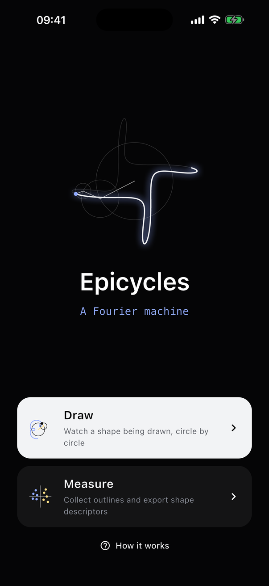
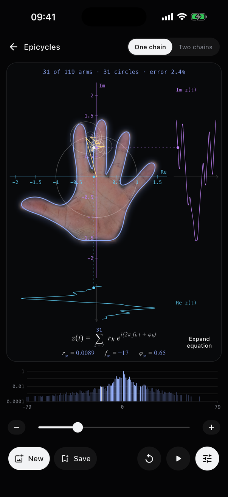
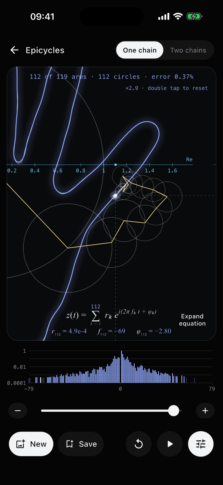
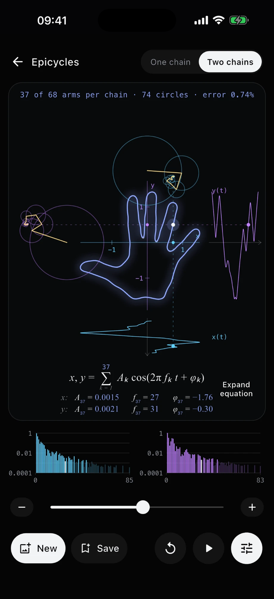
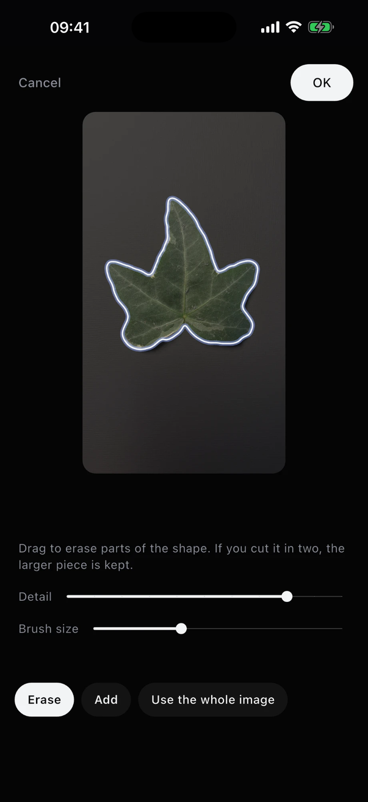
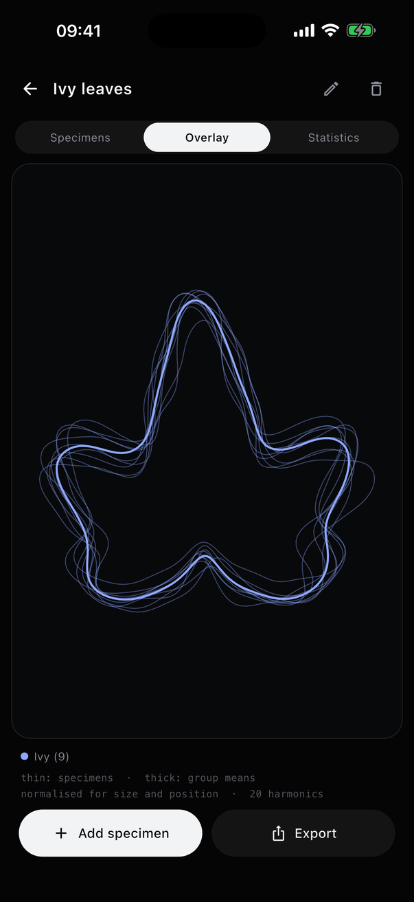
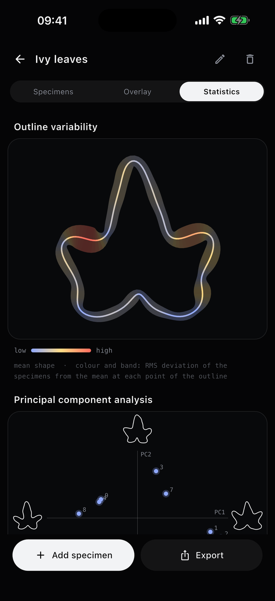
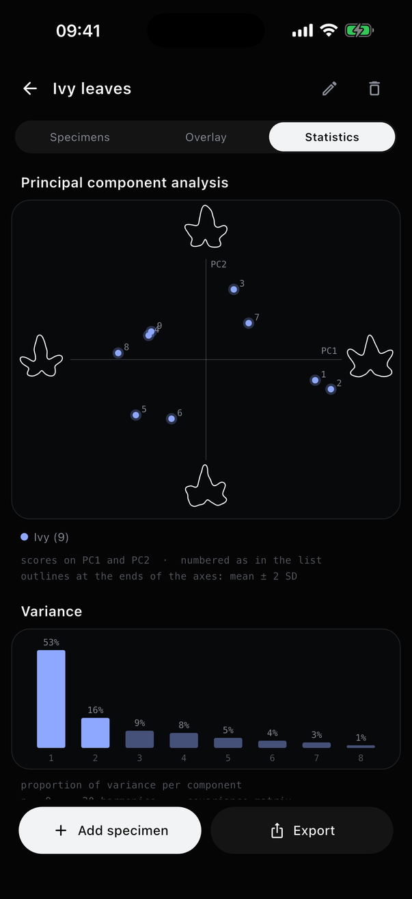
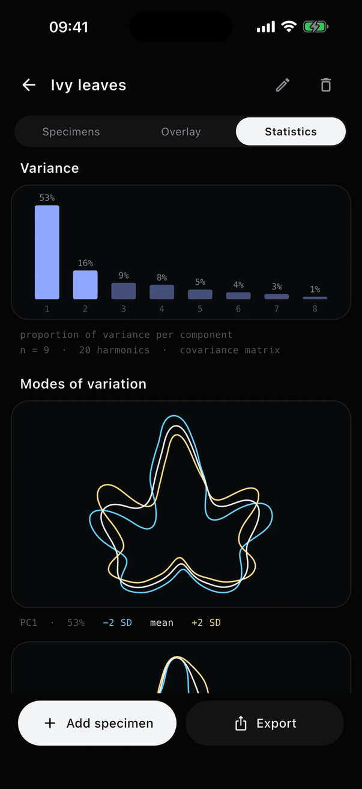

# Epicycles

*A Fourier machine.*

An iPhone app that takes the outline of an object from a photo and writes it as a
Fourier series. It then uses that series in two ways: to draw the outline with a
chain of rotating circles, and to measure it, turning shapes into numbers that can
be compared.

<p>
  
</p>

Written in Flutter. It runs on iPhone, iOS 17 or later.
The Android target has never been built.

## Draw

<p>
  
  
  
</p>

Pick a photo, tap the subject the phone finds, retouch the silhouette with a brush
if needed and turn it the way you like. The outline is then drawn by a chain of
circles: one circle at first, then one more at each turn, from the largest to the
smallest, until the curve and the outline can no longer be told apart.

While it runs the screen shows the arms and circles, the two components of the
motion over time, the equation with the latest term, and the spectrum with the
lines lighting up as the circles come in. You can drag through the arms, zoom in
on the pen to see the smallest ones, read the full equation and copy it, or export
the spectrum as a table.

A second view splits the motion into x(t) and y(t), each drawn by its own chain.

## Measure

<p>
  
  
  
  
  
</p>

One outline says little; the interesting part is how the outlines of a collection
differ. Measure stores each outline as elliptic Fourier descriptors (Kuhl and
Giardina, 1982), the standard representation in outline morphometrics.

Photograph the objects one at a time, lined up on the cross-hair, and give each a
name and a group (both can be changed later). A collection then shows:

- every outline overlaid at the same size, with the mean shape of each group;
- outline variability: the mean shape coloured by the RMS deviation of the
  specimens at each point;
- a principal component analysis of the descriptors: scores on PC1 and PC2, with
  the outline found at each end of the axes;
- the variance of each component and the modes of variation, as the mean shape
  with the shapes two standard deviations either side of it along PC1 to PC3.

The descriptors can be exported as a tab-separated table, one row per specimen,
with the coefficients in the column order used by the R package Momocs.

### Collection files

A collection can be exported as a single JSON file and imported again, on the same
phone or another one. The file can also be written by other software, which is a
way to bring in outlines from existing image archives:

```json
{
  "format": "epicycles-collection",
  "version": 1,
  "name": "Ivy leaves",
  "specimens": [
    { "name": "Leaf 1", "group": "north", "outline": [x0, y0, x1, y1, ...] }
  ]
}
```

Only `outline` is required: a closed outline with y pointing up, in any unit and
with points at any spacing. It is resampled to 1024 equal steps and its descriptors
are computed on import. Files exported by the app also carry the raw coefficients
(`a`, `b`, `c`, `d`, 40 harmonics), which are then used as they are.

## How it works

The photo is reduced to 480 px and the silhouette is traced with marching squares
at sub-pixel precision. The contour is resampled at constant steps along its
length (1024 to 8192 points) and read as a periodic complex signal
z(t) = x(t) + i y(t). An FFT gives its coefficients: each one is a circle, with a
radius, a whole number of turns per loop and a starting angle.

For drawing, the terms are sorted by radius, which gives the best approximation
in the least-squares sense for any number of terms. Arms are added until the
largest gap between the curve and the outline falls below 0.3% of the longer side;
that number, not a fixed one, is how many circles a shape gets. The origin is the
centroid and the unit is the radius of the largest circle.

For measuring, the same series is written as four coefficients per harmonic and
normalised. Position and size are always removed. Orientation is either the one
given by the operator, which is what the app uses for its own views, or the major
axis of the first ellipse, as in Momocs. In the first case the starting point is
taken where the first ellipse stands above its centre, which stays well defined
for shapes about as wide as they are tall, where the major axis does not.

## What has been checked

- The descriptors against Momocs 1.5.0, running its own `efourier` and
  `efourier_norm` on an outline produced by the app (one shape, 40 harmonics):
  raw coefficients agree within 4e-4 of the first radius, normalised ones within
  1e-3. The difference comes from the parametrisation at sharp corners.
- The principal components against numpy on the same data.
- The core has unit tests on synthetic shapes: exact reconstruction, the
  normalisations and their invariances, the exported tables.

What has not: there are no tests of the interface, and the repeatability of a
measurement across photos of the same object has not been quantified yet. A first
trial on nine ivy leaves gave sensible shapes and exposed an unstable starting
point, since fixed; it is not a validation.

## Limits

- Outlines come from a 480 px image. That is fine for drawing and coarse for
  measuring small objects.
- Size is in pixels, not a physical length.
- One outline per shape: holes and detached parts are ignored.
- The app describes collections but does no statistical testing. That is what the
  exported table is for.

## Building

Flutter 3.47 and Xcode.

```
flutter pub get
flutter test
flutter build ios --release
```

Subject detection and the camera do not work in the iOS Simulator.

If the project sits in an iCloud-synced folder, code signing fails on the extended
attributes iCloud adds to build products. Making `build` a symlink to a folder
outside iCloud avoids it.

## Layout

```
lib/core      contour extraction, Fourier series, descriptors, PCA (pure Dart)
lib/shared    photo to silhouette, camera, theme
lib/draw      the drawing screen
lib/measure   collections, statistics, export
test          tests of the core
tool          dumps an outline and its descriptors, to compare with other software
```

The Vision call that finds the subjects is in `ios/Runner/AppDelegate.swift`.

## References

- F. P. Kuhl and C. R. Giardina, Elliptic Fourier features of a closed contour,
  *Computer Graphics and Image Processing* 18 (1982).
- V. Bonhomme et al., Momocs: outline analysis using R, *Journal of Statistical
  Software* 56 (2014).

## Privacy

The app collects no data. See [PRIVACY.md](PRIVACY.md).

## License

MIT. See [LICENSE](LICENSE).
