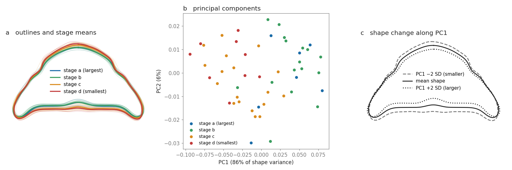

# Example: trilobite head shields

Trilobites were marine arthropods, now extinct, with segmented bodies and a hard
exoskeleton. The cephalon, or head shield, was the rigid plate covering the front of
the body. Its shape changed as the animal grew.

This example uses Measure to analyse 50 cephalon outlines of the Late Devonian
trilobite *Trimerocephalus lelievrei*, across four growth stages. The descriptors
capture the change, as smaller heads are relatively taller, while the two largest
stages have very similar shapes. This pattern is already known from earlier analyses
of the same data, so the example here also serves as a check against them.

**(a)** Every outline (thin lines) and the mean outline of each stage (thick lines),
after removing position and size. **(b)** Each outline as a point on the first two
principal components, the two directions in which the shapes vary most. **(c)** The
mean shape, and the shape two standard deviations along PC1 in each direction: the
main way these head shields differ.

## Try it

- **In the app.** Save `Trilobites.epicycles.json` to the Files app on the iPhone (for example
  through iCloud Drive, or by AirDrop from a Mac). In the app, open Measure → Collections → Import
  from file and choose it. The app computes the descriptors on import; the collection opens with
  the four stages as groups, ready for the Overlay and Statistics views.
- **In Python.** From this folder, `python3 analyse.py` (needs numpy and matplotlib) prints every
  number below and redraws `trilobites.png`.

## Results

- **One axis dominates.** PC1 carries 85.9% of the shape variance (PC2 6.4%). It is mostly the
  elongation of the outline: 81% of its weight is on the first harmonic, the best-fitting ellipse,
  and it correlates with the height-to-width ratio at r = −0.89. That ratio falls from 0.60 in
  stage d and 0.57 in stage c to 0.54 in stages b and a: larger heads are relatively wider. In this
  registration (outlines centred and scaled to the same size), most of the change appears on the
  straight posterior margin (panel c).
- **Shape follows size, mostly between stages.** PC1 correlates with log size at r = 0.77 across
  all outlines, and at r = 0.43 within stages (stage means removed).
- **The two largest stages look alike.** Mean PC1 score: a 0.034, b 0.039, c −0.025, d −0.044.
  Stages a and b are not distinguishable here (distance between their means on PC1–3, permutation
  test: p = 0.71, with 7 and 16 outlines).
- **Stage can be guessed from shape, but not well.** Each outline was assigned to the nearest
  stage mean on PC1–3, computed without that outline (leave-one-out). 23 of 50 are right. Putting
  every outline in the most numerous stage (c) would give 18; with the stage labels shuffled 1000
  times, the same procedure gives 12.4 on average and 23 or more in 0.8% of shuffles (p = 0.008).
  Most errors (22 of 27) fall on a neighbouring stage, and no stage-a outline is classified
  correctly:

  | true \ assigned | a | b | c | d |
  |---|---|---|---|---|
  | a | 0 | 5 | 2 | 0 |
  | b | 5 | 10 | 1 | 0 |
  | c | 3 | 0 | 8 | 7 |
  | d | 0 | 0 | 4 | 5 |

The PAST case study built on these data describes the same picture in its suggested answers: shape
changes systematically through growth, consecutive size classes overlap considerably, and the first
two classes cannot be told apart. Crônier et al. (1998) report that the main shape changes happen
early in development and that size keeps increasing after the adult shape is reached, which fits
the two largest stages sharing one shape.

## Method

Each outline (64 digitised points) is resampled to 1024 points equally spaced along its length.
Its elliptic Fourier series, the outline written as a sum of ellipses turning at whole-number
speeds, is computed up to 20 harmonics. The coefficients are normalised for position, size (the
first ellipse's semi-major axis) and starting point, keeping the orientation in which the outlines
were digitised: the app's default, "as oriented". Principal components are computed on the 80
normalised coefficients (20 harmonics × 4); the sign of PC1 is set so that it increases with size.
This is the same computation as the app's; the size correlations, the classification and the
permutation tests are only in the script.

## Where the data come from

Crônier et al. (1998) digitised the outlines for a study of the growth of *T. lelievrei*, from the
Famennian of Morocco. Catherine Crônier provided them to the PAST case study "Shape change through
trilobite ontogeny", which accompanies the software PAST and Hammer & Harper (2005); the R package
Momocs distributes them as the dataset `trilo` (Bonhomme et al. 2014). The original file has 51
outlines in five stages; Momocs dropped the fifth stage, which has a single outline. The JSON here
was converted from Momocs's copy in October 2026; its coordinates are identical to the 50
corresponding outlines of the original PAST file, `outlines.dat`.

The stage letters run from the largest to the smallest heads. The sources call the stages
"size classes" without giving their order; it follows from the outline widths, which do not overlap
between stages (in the file's units: a 9.8–11.7, b 7.2–9.6, c 4.8–6.5, d 3.9–4.6), and the dropped
fifth stage is the smallest of all (2.8). The units are not stated in the sources; the collection
file labels them "pixels" because that is the app's format.

## Limits

- 50 outlines in unequal stages (7 to 18). The classification is a simple check, not a model.
- The principal components are computed once on all outlines, including the one held out in each
  leave-one-out step. PCA does not use the stage labels, but the held-out outline still shapes the
  axes.
- 20 harmonics give 80 coefficients for 50 outlines; the highest harmonics probably carry
  digitisation noise. The number of harmonics was not varied.
- The earlier analyses used a different setup (PAST: 10 harmonics, 40 coefficients), so their
  numbers are not directly comparable with these.
- The orientation is the one of the original digitisation; it was not checked against the
  specimens.

## Licence of this folder

The coordinates in `Trilobites.epicycles.json` come from Momocs, which is distributed under the GNU
General Public License, version 3 or later. That file is redistributed under the same licence; its
text is in `LICENSE-GPL-3.0.txt`. The rest of this folder (`analyse.py`, the figure, this README) is
under the repository's MIT licence.

## References

- Crônier C, Renaud S, Feist R, Auffray J-C (1998). Ontogeny of *Trimerocephalus lelievrei*
  (Trilobita, Phacopida), a representative of the Late Devonian phacopine paedomorphocline: a
  morphometric approach. *Paleobiology* 24(3): 359–370.
  [Cambridge Core](https://www.cambridge.org/core/journals/paleobiology/article/ontogeny-of-trimerocephalus-lelievrei-trilobita-phacopida-a-representative-of-the-late-devonian-phacopine-paedomorphocline-a-morphometric-approach/87877E8F6C6955F4E3ED7E45BC40E97B)
- Hammer Ø, Harper DAT (2005). *Paleontological Data Analysis*. Blackwell.
  https://doi.org/10.1002/9780470750711
- PAST case study 4, "Shape change through trilobite ontogeny", its
  [suggested answers](https://palaeo-electronica.org/2001_1/past/pastprog/study4tips.html) and
  [data file](https://palaeo-electronica.org/2001_1/past/pastprog/outlines.dat).
  https://palaeo-electronica.org/2001_1/past/pastprog/study4.html
- Bonhomme V, Picq S, Gaucherel C, Claude J (2014). Momocs: outline analysis using R. *Journal of
  Statistical Software* 56(13). https://doi.org/10.18637/jss.v056.i13
